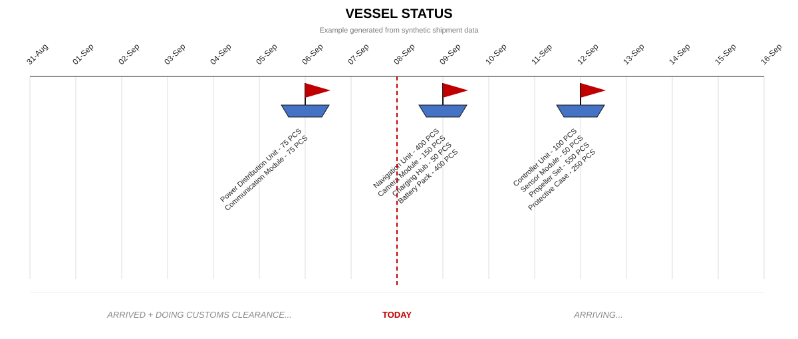

# Logistics Vessel Tracker

A vessel-arrival monitoring workflow built with **Excel dynamic-array formulas** and **Python in Excel**. It converts item-level shipment records into a shipment-level summary, filters records by operational status, and displays active arrivals on a rolling timeline.

## What the workflow does

The same shipment key can appear in several rows because one shipment contains multiple commodities. The workflow restructures these records in three steps:

1. **Shipment aggregation** — retrieve one arrival date and delivery date per shipment, then combine its commodity lines.
2. **Operational date view** — map active shipments to a calendar ending at `TODAY()+8`. The start date is the earlier of `TODAY()-8` and the oldest arrival that still has no completed delivery.
3. **Vessel visualization** — clean the transformed range with pandas and plot arrivals with Matplotlib.

## Source data — `Sheet1`

The table below represents the item-level source. `Shipment ID` is the shipment key or bill of lading (B/L), while `ATA LCB` is the actual arrival date used to position the shipment on the timeline. Column references used by the workbook are documented in [Excel transformation logic](docs/excel_formulas.md).

| Shipment ID | ATA LCB | Delivery date | Commodity | Qty | Unit |
|---|---|---|---|---:|---|
| SYN-BL-001 | 04-Sep-2026 | 07-Sep-2026 | Inspection Camera | 80 | PCS |
| SYN-BL-001 | 04-Sep-2026 | 07-Sep-2026 | Mounting Bracket | 80 | PCS |
| SYN-BL-005 | 06-Sep-2026 | — | Power Distribution Unit | 75 | PCS |
| SYN-BL-005 | 06-Sep-2026 | — | Communication Module | 75 | PCS |
| SYN-BL-002 | 09-Sep-2026 | 0 | Navigation Unit | 400 | PCS |
| SYN-BL-002 | 09-Sep-2026 | 0 | Camera Module | 150 | PCS |
| SYN-BL-002 | 09-Sep-2026 | 0 | Charging Hub | 50 | PCS |
| SYN-BL-002 | 09-Sep-2026 | 0 | Battery Pack | 400 | PCS |
| SYN-BL-003 | 12-Sep-2026 | 16-Sep-2026 | Controller Unit | 100 | PCS |
| SYN-BL-003 | 12-Sep-2026 | 16-Sep-2026 | Sensor Module | 50 | PCS |
| SYN-BL-003 | 12-Sep-2026 | 16-Sep-2026 | Propeller Set | 550 | PCS |
| SYN-BL-003 | 12-Sep-2026 | 16-Sep-2026 | Protective Case | 250 | PCS |

## Transformation 1 — shipment-level summary

`UNIQUE`, `XLOOKUP`, and `HSTACK` create one row per shipment. `FILTER` and `TEXTJOIN` combine all commodities belonging to that shipment.

| Shipment ID | ATA LCB | Delivery date | Commodity summary |
|---|---|---|---|
| SYN-BL-001 | 04-Sep-2026 | 07-Sep-2026 | Inspection Camera - 80 PCS Mounting Bracket - 80 PCS |
| SYN-BL-005 | 06-Sep-2026 | — | Power Distribution Unit - 75 PCS Communication Module - 75 PCS |
| SYN-BL-002 | 09-Sep-2026 | 0 | Navigation Unit - 400 PCS Camera Module - 150 PCS Charging Hub - 50 PCS Battery Pack - 400 PCS |
| SYN-BL-003 | 12-Sep-2026 | 16-Sep-2026 | Controller Unit - 100 PCS Sensor Module - 50 PCS Propeller Set - 550 PCS Protective Case - 250 PCS |

## Transformation 2 — dynamic active-date table

For a reproducible example, **08-Sep-2026** is treated as `TODAY`. The live workbook uses the actual `TODAY()` value. A blank delivery date means no date has been entered, while `0` can be returned by the source system or an upstream Excel formula when no valid date exists. This workflow interprets both values as **no confirmed delivery date**. A shipment remains visible when its delivery date is blank, zero, or later than today; a delivery date equal to today is excluded because the current business rule treats it as delivered.

The live calendar normally begins at `TODAY()-8`, but it expands further into the past when an older shipment is still active. This allows an undelivered ship to remain visible on the left side of the moving `TODAY` line until a completed delivery date is recorded. In this example, `SYN-BL-005` arrived on 06-Sep without a delivery date, so it remains on the chart after the `TODAY` line has moved past it. Only two upcoming ships are shown after `TODAY` to keep the visualization focused.

| Offset | Date | Active commodity summary | Plot flag |
|---:|---|---|---:|
| -8 | 31-Aug-2026 | — | 0 |
| -7 | 01-Sep-2026 | — | 0 |
| -6 | 02-Sep-2026 | — | 0 |
| -5 | 03-Sep-2026 | — | 0 |
| -4 | 04-Sep-2026 | — *(delivered 07-Sep)* | 0 |
| -3 | 05-Sep-2026 | — | 0 |
| -2 | 06-Sep-2026 | Power Distribution Unit - 75 PCS Communication Module - 75 PCS | 1 |
| -1 | 07-Sep-2026 | — | 0 |
| 0 | **08-Sep-2026 TODAY** | — | 0 |
| +1 | 09-Sep-2026 | Navigation Unit - 400 PCS Camera Module - 150 PCS Charging Hub - 50 PCS Battery Pack - 400 PCS | 1 |
| +2 | 10-Sep-2026 | — | 0 |
| +3 | 11-Sep-2026 | — | 0 |
| +4 | 12-Sep-2026 | Controller Unit - 100 PCS Sensor Module - 50 PCS Propeller Set - 550 PCS Protective Case - 250 PCS | 1 |
| +5 | 13-Sep-2026 | — | 0 |
| +6 | 14-Sep-2026 | — | 0 |
| +7 | 15-Sep-2026 | — | 0 |
| +8 | 16-Sep-2026 | — | 0 |

### How the final column is used

The final numeric column is a **plot flag**, not the commodity quantity from `Sheet1`. A positive value tells Python to draw a ship for that date; `0` means that no active shipment should be plotted. This distinction prevents the source `Qty` field from being confused with the chart-control value.

### Processing assumptions

- Every row with the same Shipment ID is expected to contain the same arrival and delivery dates. `XLOOKUP` returns the first matching dates.
- An arrival date determines the ship's horizontal position; the delivery-date rule determines whether the shipment remains visible.
- If a date is displayed as text with `TODAY` appended, Python removes that label before converting the value to a date.
- Python reads `G1:I1000` so the calendar can expand backwards for long-running undelivered shipments. Unused rows are allowed because rows without a valid date are removed during cleaning.

## Python visualization

The code in [`src/vessel_status.py`](src/vessel_status.py):

- reads `G1:I1000` through Python in Excel's `xl()` function;
- removes the appended `TODAY` label before parsing dates;
- converts invalid dates to missing values and invalid quantities to zero;
- draws a ship only when the plot flag is positive;
- marks today's position with a red dashed line; and
- places the three footer statuses at fixed relative positions so they remain separated.

## Run in Python in Excel

1. Create the rolling table with the columns `Date`, `Commodity`, and a positive/zero plot flag.
2. Place it in `G1:I1000`, or change `SOURCE_RANGE` if the operational history can exceed this capacity.
3. Insert a Python cell and copy the code from `src/vessel_status.py`.
4. Keep `fig` as the final expression so Excel displays the chart.

The script is intended for **Python in Excel** because `xl()` is supplied by Excel. Running the file directly in a standard Python interpreter requires replacing `xl()` with another data-loading method.

All identifiers, commodities, quantities, and dates shown above are fictional and demonstrate the processing logic only.
